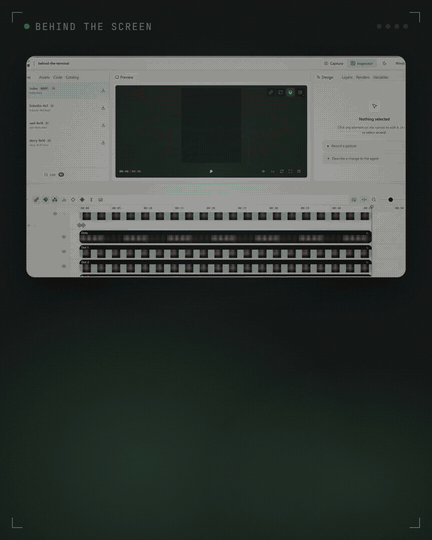
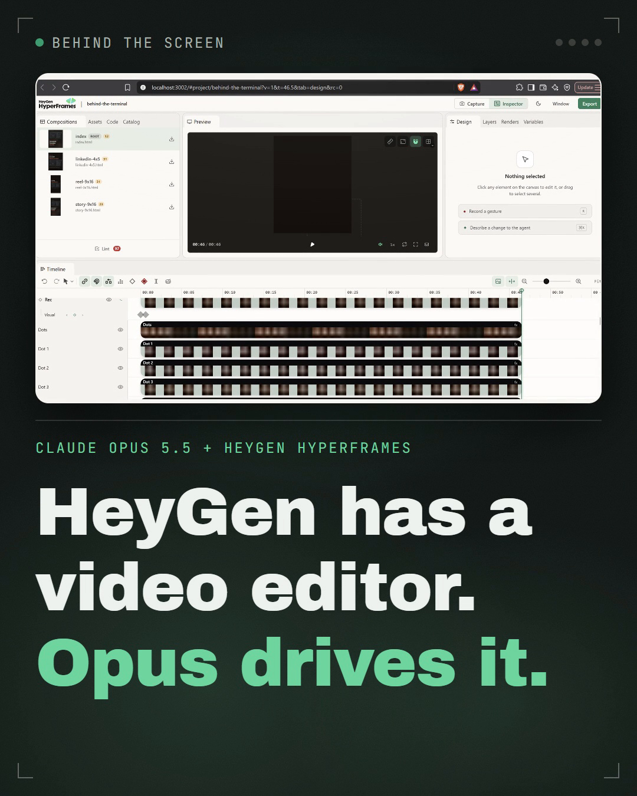
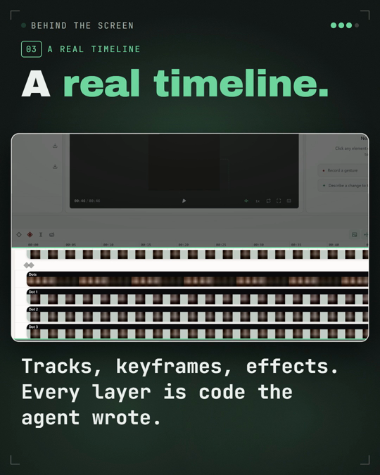
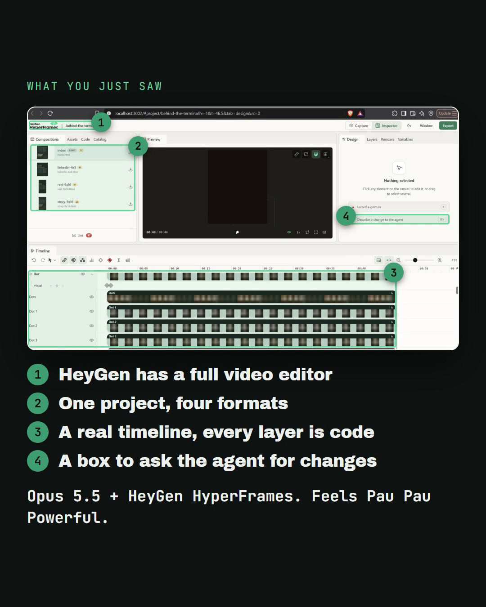

<div align="center">

# Screenshot to Social

**Turn one screenshot of real work into a ready-to-post, behind-the-scenes video package for Instagram, LinkedIn and X.**

A [Claude Code](https://claude.com/claude-code) skill. Give it a screenshot and the message you want it to carry; it gives you back motion-design videos with music for every platform, plus covers, captions and step-by-step posting instructions.

[](LICENSE)




</div>

---

## Contents

- [Why](#why)
- [What you give it](#what-you-give-it)
- [What you get](#what-you-get)
- [Installation](#installation)
- [Requirements](#requirements)
- [Usage](#usage)
- [How it works](#how-it-works)
- [Example](#example)
- [Customising](#customising)
- [Repository layout](#repository-layout)
- [Testing](#testing)
- [Troubleshooting](#troubleshooting)
- [Limitations](#limitations)
- [Contributing](#contributing)
- [License](#license)

## Why

A screenshot of real work is proof: nobody staged it. But posted as-is, people scroll past it without seeing what makes it interesting. This skill turns the screenshot into a short video that points straight at what matters, one detail at a time, in plain words and big bold type, with music, then recaps everything on a single card.

It's built for build-in-public updates, AI-agent sessions, terminals, IDEs, dashboards, design tools and docs. Anything where the real screen tells the story better than a polished ad.

## What you give it

| Input | Required | Example |
| --- | --- | --- |
| **The screenshot** | Yes | A PNG or JPG of your screen. Landscape or portrait. |
| **The theme or message** | Yes | *"Opus drove HeyGen's video editor. A pleasant surprise. Feels powerful."* |
| The points to show | Optional | *"People should notice the parallel projects, my own prompt, and the agent acting as a reader."* If you leave this out, the skill picks the 3 to 5 details that prove your theme and skips the rest. |
| Tone, platforms, privacy | Optional | *"Calm, Instagram and LinkedIn only, blur the client name."* |

## What you get

Everything lands in `videos/<project>/renders/post/`, named by platform:

| File | Format | Contents | Where to post it |
| --- | --- | --- | --- |
| `instagram-reel_9x16.mp4` | 1080×1920 video, 9:16 | Video plus recap card at the end | Instagram Reels (also TikTok and YouTube Shorts) |
| `instagram-story-2-video_9x16.mp4` | 1080×1920 video, 9:16 | Video only | Instagram Story, frame 1 |
| `recap-card_9x16.png` | 1080×1920 image | Your screenshot with every point pinned and numbered | Instagram Story, frame 2 |
| `cover_9x16.png` | 1080×1920 image | The opening hook | Reel cover |
| `linkedin-video_4x5.mp4` | 1080×1350 video, 4:5 | Video plus recap card at the end | LinkedIn native video |
| `cover_4x5.png` | 1080×1350 image | The opening hook | LinkedIn thumbnail |
| `x-2-video_4x5.mp4` | 1080×1350 video, 4:5 | Video only | X (Twitter), post 1 of a thread |
| `recap-card_4x5.png` | 1080×1350 image | Recap card | X post 2, LinkedIn first comment |
| `original-screenshot.png` | Original size | Your untouched screenshot | X post 2, LinkedIn first comment |
| `POSTING.md` | Markdown | Per-platform steps, ready-to-paste captions with hashtags, alt text, stickers, first comment, posting order and privacy notes | Your checklist while posting |

Every video:
- has original music matched to your tone, with scene changes cut on the beat
- is normalised to -14 LUFS, the loudness the platforms expect
- runs 59 seconds or less (usually 30 to 45)
- keeps text inside each platform's safe zones and readable with the sound off

You also get the editable project (`beats.json` plus HyperFrames compositions) if you want to tweak it in HyperFrames Studio.

## Installation

### Option 1: Claude Code plugin (recommended)

Run these two commands inside Claude Code:

```
/plugin marketplace add 0msm0/screenshot-to-social
/plugin install screenshot-to-social@screenshot-to-social
```

Restart Claude Code if it asks you to. To update later, run `/plugin marketplace update screenshot-to-social`.

### Option 2: Skills CLI

```bash
npx skills add 0msm0/screenshot-to-social
```

### Option 3: Manual install

**macOS / Linux**

```bash
git clone https://github.com/0msm0/screenshot-to-social.git
mkdir -p ~/.claude/skills
cp -r screenshot-to-social/skills/screenshot-to-social ~/.claude/skills/
```

**Windows (PowerShell)**

```powershell
git clone https://github.com/0msm0/screenshot-to-social.git
New-Item -ItemType Directory -Force "$HOME\.claude\skills" | Out-Null
Copy-Item -Recurse screenshot-to-social\skills\screenshot-to-social "$HOME\.claude\skills\"
```

To make the skill available in one project only, copy it into that project's `.claude/skills/` folder instead.

### Install the rendering skills

The videos are rendered with [HyperFrames](https://www.npmjs.com/package/hyperframes), so install its skills once:

```bash
npx hyperframes skills update hyperframes media-use
```

### Check your setup

```bash
python ~/.claude/skills/screenshot-to-social/scripts/run_pipeline.py --env
```

It prints `toolchain ok`, or tells you exactly what's missing. (Plugin installs keep the skill in Claude Code's plugin folder; there you can ask Claude to "check the screenshot-to-social toolchain".)

## Requirements

| Tool | Version | What it's for |
| --- | --- | --- |
| [Claude Code](https://claude.com/claude-code) | Recent | Runs the skill |
| [Node.js](https://nodejs.org) | 18 or later | Runs `npx hyperframes`, which renders the videos |
| [ffmpeg](https://ffmpeg.org) | Any recent build, on your `PATH` | Audio mixing, loudness and still frames |
| [Python](https://www.python.org) | 3.10 or later | Build, music and finishing scripts |
| Pillow | `pip install pillow` | Measures fonts so headlines fit |
| Music generation (optional) | `pip install -r requirements-music.txt` | Writes original music offline with MusicGen. Skip it if you'd rather use your own track or a HeyGen library track. |

The first offline music run downloads the `facebook/musicgen-small` model (about 300 MB). On a CPU it takes a few minutes, and the skill starts it early so it runs while everything else is built.

## Usage

Put the screenshot in your working folder, open Claude Code there and say what you want. Plain language works:

```text
Here's a screenshot of my terminal (shot.png). Make something I can post.
Theme: I'm running four agents in parallel on one refactor and they didn't step on each other.
```

```text
shot.png is two Claude Code sessions side by side. People should notice that I run projects
in parallel, the agent's reasoning, and my own prompt steering it. Calm tone. Insta and LinkedIn.
```

```text
Another one for the behind-the-screen series, from dashboard.png. Theme: our signup funnel finally works.
```

The skill:
1. reads the screenshot and suggests the points worth showing
2. asks only what the screenshot can't tell it, such as project names, what's private, and which points matter most
3. builds, renders and packages everything

A full run takes about 10 to 20 minutes, most of it rendering and music. You can also call it directly with `/screenshot-to-social`.

## How it works

```
screenshot + theme
      │
      ▼
 1. Read like an editor ──▶ pick 3–5 points that prove the theme, cut incidental details
      │
      ▼
 2. beats.json ──────────▶ hook → one beat per point → statement → close → recap card
      │                    (coordinates measured on a grid, copy in plain words)
      ▼
 3. build_composition.py ▶ HyperFrames compositions: master + 4:5 / 9:16 / recap variants
      │                    (type auto-fits the free space; text sits beside the screenshot, not on it)
      ▼
 4. make_music.py ───────▶ mood from your tone → music bed; scene changes snapped to the beat
      │
      ▼
 5. hyperframes render ──▶ four platform videos
      │
      ▼
 6. finish.py ───────────▶ -14 LUFS, covers, recap cards, platform file names
      │
      ▼
 7. POSTING.md ──────────▶ captions, alt text and steps for each platform
```

Steps 3 to 6 run with one command, `scripts/run_pipeline.py`. It stops at the first failure and says how to fix it.

**Design rules the skill follows**
- Point straight at the detail. No "look closely" teasers.
- Big, bold headlines of 2 to 6 words, plus one everyday sentence. No file names, URLs or field lists.
- Text goes in the free space above or below the screenshot. It only sits on top of the screenshot when the screenshot is a portrait shot that fills the frame.
- The layout changes from beat to beat (centred, split, low) so it never feels like a slideshow.
- Pacing follows reading time, and the energy (calm, lively or punchy) sets both camera speed and music.
- Quotes are verbatim. It makes no claim that the screenshot or you don't support.

## Example

[`examples/hyperframes-studio/`](examples/hyperframes-studio) holds a complete run:
- **Input:** [`input.png`](examples/hyperframes-studio/input.png), a HyperFrames Studio screenshot.
- **Theme:** *"Opus 5.5 uses the agentic video editor provided by HeyGen HyperFrames. A pleasant surprise. Feels Pau Pau Powerful."*

<table>
<tr>
<td align="center"><br><sub>Cover (4:5)</sub></td>
<td align="center"><br><sub>A point beat</sub></td>
<td align="center"><br><sub>Recap card (4:5)</sub></td>
</tr>
</table>

| File | What it shows |
| --- | --- |
| [`beats.json`](examples/hyperframes-studio/beats.json) | The script the skill wrote |
| [`POSTING.md`](examples/hyperframes-studio/POSTING.md) | The generated playbook and captions |

The videos are too large for the repository; download them from the [Releases](https://github.com/0msm0/screenshot-to-social/releases) page.

## Customising

Everything about a piece lives in `beats.json` in the project folder. Edit it, then rerun the pipeline:

```bash
python <skill>/scripts/run_pipeline.py videos/<project>
```

| Field | Effect |
| --- | --- |
| `energy` | `calm`, `lively` or `punchy`. Sets camera speed and music mood. |
| `music.mood` / `music.prompt` | Override the mood (`reflective`, `cinematic`, `playful`, …) or write your own MusicGen prompt |
| `palette.accent` | Highlight colour; pick one from your screenshot |
| `beats[].layout` | Force `center`, `split` or `low` for a beat |
| `allow_long` | Allow a video over 59 s. Use sparingly. |

To use your own music, save it as `assets/bgm/seed.wav` and run `make_music.py <project> --from-seed assets/bgm/seed.wav`. The full schema is in [`references/config-schema.md`](skills/screenshot-to-social/references/config-schema.md).

## Repository layout

```
screenshot-to-social/
├── .claude-plugin/
│   ├── plugin.json               # Claude Code plugin manifest
│   └── marketplace.json          # lets /plugin marketplace add install it
├── skills/screenshot-to-social/  # the skill itself (this is what gets installed)
│   ├── SKILL.md                  # workflow, examples, troubleshooting
│   ├── references/               # story craft, layout schema, music, platform specs
│   ├── scripts/                  # build, music, beat-sync, finish, one-command pipeline
│   └── assets/                   # example beats.json, fonts (SIL OFL)
├── examples/hyperframes-studio/  # a complete input and output
├── evals/                        # functional evals and trigger tests
├── tools/                        # trigger tester, packager
└── docs/images/                  # README media
```

## Testing

**Trigger tests** check that Claude picks the skill for screenshot-to-post requests, and doesn't pick it for near-misses like "crop this screenshot" or "fix the bug in this screenshot":

```bash
python tools/trigger_test.py --runs 2
```

Version 1.0.0 passes 16 of 16 queries.

**Functional evals** in [`evals/evals.json`](evals/evals.json) describe three end-to-end scenarios with checkable assertions:
- a landscape screenshot with a theme only
- a case where you name the points yourself
- a portrait phone screenshot

Eval 1 uses the bundled example. For evals 2 and 3, add your own screenshots to `evals/inputs/`.

**Packaging** for claude.ai or a release:

```bash
python tools/package_skill.py   # writes dist/screenshot-to-social.skill
```

## Troubleshooting

| Problem | Fix |
| --- | --- |
| `STOP: npx not found` | Install Node.js 18 or later and reopen your terminal |
| `MusicGen needs torch` | `pip install -r requirements-music.txt`, or supply your own track with `--from-seed` |
| `missing SFX` | `npx hyperframes skills update media-use`. The video still renders without clicks and whooshes. |
| "the video runs 6x s" | Too many points. Cut the weakest one, or tighten the headlines. |
| Headline comes out small | Too many words. Cut words rather than shrinking the type. |
| Changes made in Studio disappear | The pipeline rebuilds from `beats.json`, so put your changes there |

There's more in the skill's [troubleshooting table](skills/screenshot-to-social/SKILL.md#troubleshooting).

## Limitations

- **Claude Code only.** Rendering needs Node, ffmpeg and Python on your machine. You can upload the `.skill` file to claude.ai, but it can't render videos there.
- **Music is generated, not listened to.** Claude can't hear the result, so play it once before you post. You can always swap in your own track.
- **Check privacy before posting.** The skill flags names, emails and unreleased details it notices. The screenshot is still yours to check.
- Tested mainly with Claude Opus. Smaller models work, but may need more back-and-forth to agree on the points.

## Contributing

Issues and pull requests are welcome. See [CONTRIBUTING.md](CONTRIBUTING.md). Before you open a PR that changes `SKILL.md` or its description, run the trigger tests.

## License

[MIT](LICENSE) © Manas. Bundled fonts (Instrument Serif, Archivo Black, JetBrains Mono) are under the [SIL Open Font License 1.1](skills/screenshot-to-social/assets/fonts/LICENSE.txt).

## Acknowledgements

- [HyperFrames](https://www.npmjs.com/package/hyperframes) by HeyGen, the HTML-to-video renderer
- [MusicGen](https://huggingface.co/facebook/musicgen-small) by Meta, for offline music
- Anthropic's [Complete Guide to Building Skills for Claude](https://resources.anthropic.com/hubfs/The-Complete-Guide-to-Building-Skill-for-Claude.pdf), which shaped the skill's structure
